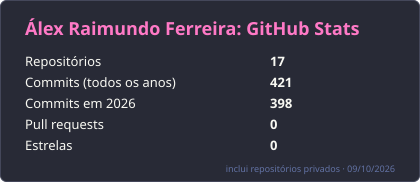
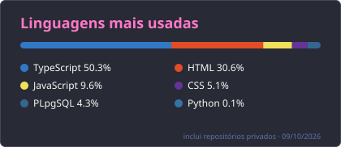

### Olá, eu sou o Álex 👋

Engenheiro de software com IA na Sinapses AI. Projeto e desenvolvo plataformas, integrações e agentes de IA, do requisito à entrega, com segurança e LGPD desde o início do projeto.

##

- 🧠 Trabalho com TypeScript full-stack (React, Next.js, NestJS, PostgreSQL) e agentes de IA
- 🏗️ Plataformas web para clientes, como um sistema de orçamento de esquadrias com motor de cálculo validado contra orçamentos reais
- 🎮 Criei o [Gamer Base](https://github.com/alex325-oss/Gamer-Base-Download), um clone de Discord com voz em tempo real, app desktop e versão para celular
- 📐 Desenvolvimento orientado a especificações, testes e documentação
- 🔐 Estudando segurança: pentest, SAST/DAST e segurança de MCP
- 🧑🏻 Pronomes: ele/dele

  
  

### Stack

  
  
  
  
  
  
  
  
  
  
  
  
  
    
  
  
  

##

  
  
  

